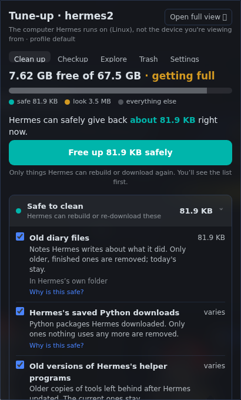
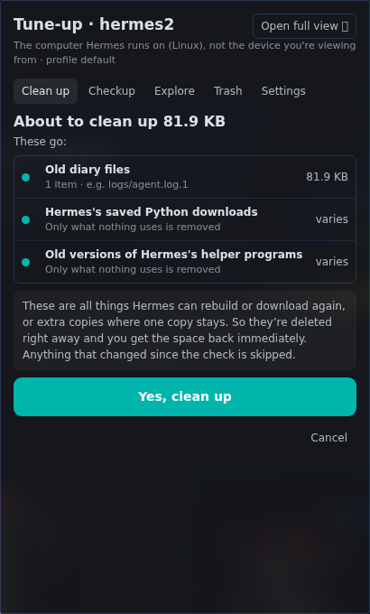
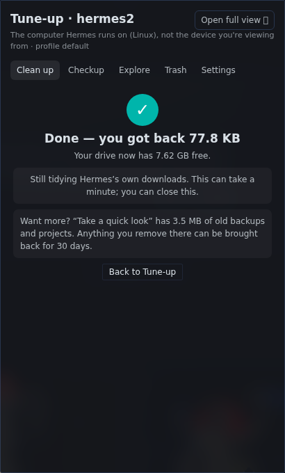
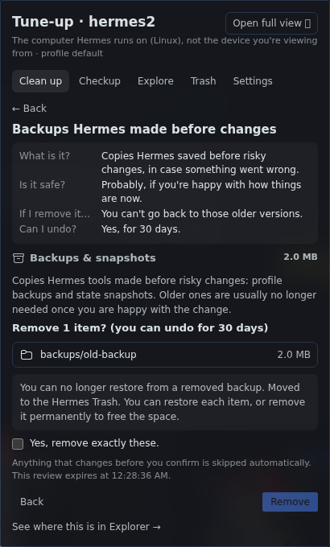
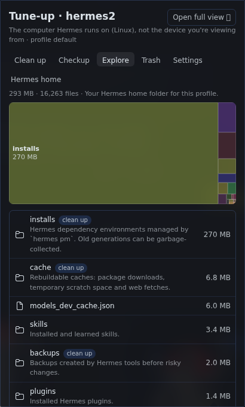
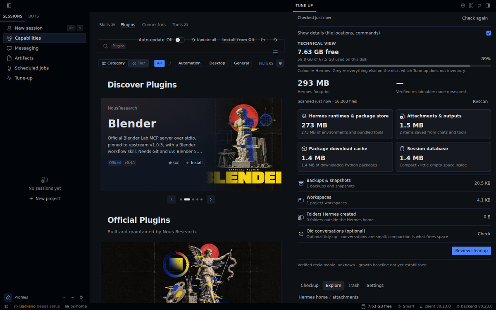
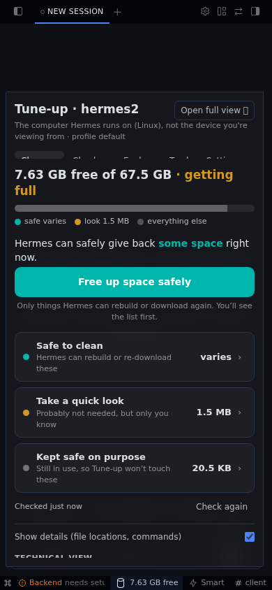

# Tune-up for Hermes

**Keep Hermes fast, healthy and tidy. See what it's storing, free up space safely, check its health, and stop what agents left running.**

[](https://github.com/ShawnCRMer/hermes-tune-up/releases/download/v0.7.3/tune-up-promo.mp4)

▶ **[Watch the 90-second film](https://github.com/ShawnCRMer/hermes-tune-up/releases/download/v0.7.3/tune-up-promo.mp4)**. The scan numbers in it come from a real Hermes install before cleanup; the animated scenes are illustrations.



## Why

A Hermes home grows quietly: the session database keeps empty space after old chats are removed, tools fill download caches, old runtimes and agent worktrees pile up, and background processes outlive the job that started them. Hermes ships commands for most of this (`hermes sessions prune`, `hermes pm gc`, `hermes worktree prune` and more), but most people never find them, and deleting files by hand is how you lose something you needed.

Tune-up puts all of it in one panel, in plain language, and asks before it touches anything.

## Clean up

Tune-up starts with how full the drive is, then sorts what it found into groups:

- **Safe to clean**: things Hermes can rebuild or download again, or extra copies where one copy stays. **Free up space safely** shows you the list first.
- **Take a quick look**: probably not needed, but only you know (old backups, old projects, attachments). Tap a group to choose items.
- **Kept safe on purpose**: what the safety checks held back, and why.



Every item answers **What is it? Is it safe? If I remove it…? Can I undo?** **Show details** adds file locations and the exact commands.



Results are measured: you see the real change in free space, not an estimate.



What it can clean, with your OK:

- **Session database empty space.** Measures the space SQLite keeps inside `state.db`. **Squeeze out empty space** pauses Hermes briefly to pack it, then starts it again, only after you confirm "OK to pause Hermes now" (Linux; on a Mac it shows the exact steps instead).
- **Old conversations** with `hermes sessions prune`, after a preview that shows how many match. Hermes skips pinned, archived and open sessions.
- **Download caches and old runtimes**: `uv cache prune`, `hermes pm gc`.
- **Checkpoints** and **leftover agent worktrees** (`hermes worktree prune`, with a preview first).
- **Folders Hermes created outside its home** (app workspaces, builds), found from Hermes's own session history and Kanban task folders. Inside them: exact duplicates (one copy always kept), old backup snapshots, rebuildable `node_modules` / `.venv`, large old files. An item is offered only if it isn't tracked by git, isn't open in a running program, isn't referenced by a service or crontab, isn't mentioned by a file in its project, and hasn't changed in 7 days.

## Checkup

Is everything that should be running actually running? Checkup lists Hermes's services, explains anything that's down or crash-looping in plain words, and offers a fix (start, restart, turn off, or bring it back automatically when it exits). It also finds **leftovers**: background processes agents started and never stopped, with the evidence for each, so you can stop the ones you pick.

## Explore



A size map and list of the Hermes home with a short description of what each folder is for, plus a clean-up shortcut where one applies. **Open full view** shows a large version beside your chat. **Find duplicates** compares the contents of the largest files.



## Trash

Anything you remove from **Take a quick look** goes to the Hermes Trash first. **Bring back** puts it back where it was (never over something newer). Items left in the Trash for 30 days are deleted the next time Tune-up is opened, or you can **Delete for good** right away.

## Optional: ask AI to explain

**Explain my storage** sends a short summary to a helper model: folder totals, cleanup categories and counts. It never sends file names, paths, contents or credentials. You see exactly what will be sent and tick consent first. Pick the model under **Settings → Models → Auxiliary → Storage Advisor**. It's off until you use it.

## How to open it

- **Tune-up** in the sidebar
- The free-space reading in the status bar
- The command palette: **Tune-up: Open beside chat**



## Safety

- Nothing is deleted automatically. Only **Safe to clean** items come ticked; everything in **Take a quick look** you pick yourself. You review a frozen list of exact items before anything happens, and that review expires after 15 minutes.
- On confirmation, every item is checked again. Anything that changed, was replaced, or became a link since you reviewed it is skipped.
- Items changed in the last hour, live logs and the session database's own files are never offered.
- Credential files (`.env`, `auth.json`, keys, `secrets/`) count toward sizes but are never opened, hashed, sent to AI or offered for deletion. Their names are hidden unless you opt in. Service environments and `/proc/<pid>/environ` aren't read either.
- Commands run as fixed, allow-listed argument lists (no shell), one at a time. Destructive ones need a fresh preview with the same settings.
- Every action is tied to the Hermes instance and profile you reviewed it in. Other profiles are not touched.

## Install

From Hermes Desktop: **Capabilities → Plugins**, search for **Tune-up**, then **Install**.

From the command line:

```sh
hermes plugins install storage-utility
```

Tune-up is one package with two halves: the panel in Desktop and a backend on your Hermes server that measures and cleans. The installer handles both, including when Desktop is connected to a remote gateway.

## Privacy and what it touches

- **Network:** none, except the optional AI explanation, which goes through Hermes's own model routing to the provider you chose, after you consent. No telemetry.
- **Credentials:** never read. Tune-up doesn't open `.env` files, `auth.json`, keys, service environment files, the scripts a service starts, or `/proc/<pid>/environ`. It finds which Hermes home a service belongs to from the service's own systemd settings (`Environment=`, `User=`) and whether it has the session database open; on macOS, from `HERMES_HOME` in the LaunchAgent (every other environment entry is dropped unread). Commands it runs, other than Hermes's own CLI, get only `PATH`, `HOME` and the locale, never your API keys.
- **Reads:**
  - Sizes and dates across the Hermes home.
  - Hermes's session history and Kanban task folders, to find folders Hermes created elsewhere.
  - Your home's tool caches (`~/.cache`, `~/.npm`, `~/.pnpm-store` and similar).
  - Linux: `/proc` (process lists, command lines, open files and cgroups), to see what's still in use and what agents left running.
  - Linux: systemd unit status and settings (`systemctl show/list-units`), recent service log lines (`journalctl`), `journalctl --disk-usage`.
  - macOS: the process table through `psutil` (command lines, open files, start times, listening ports; never environments), Hermes's own background-process records (`processes.json`, `spawn-ledger.json`), your Hermes LaunchAgents (`~/Library/LaunchAgents/*.plist`: label, program, `KeepAlive`, log path, and only `HERMES_HOME`/`HOME` from their environment), other launchd job settings with their environment removed (to see whether a job runs something from a project folder), `launchctl print`/`list` (state, PID, run count, last exit code only), and the last lines of a service's own error log (only a regular file in `<Hermes home>/logs`).
  - Your `crontab -l`, and `git ls-files` in project folders, to check whether a file is tracked.
- **Changes, only after you review and confirm:**
  - **Deletes** files you choose in project folders Hermes created, and in the tool caches above (npm, pip, uv, pnpm, Playwright and similar). **Free up space safely** deletes these permanently; they're things that are downloaded again when needed. Items from **Take a quick look** go to the Trash first.
  - Runs the allow-listed maintenance commands: `hermes sessions prune`, `hermes pm gc`, `hermes checkpoints prune/clear`, `hermes worktree prune`, `uv cache prune`, `pnpm store prune` and `git gc`. When Hermes runs as root it adds `journalctl --vacuum-size=200M` and `apt-get clean`.
  - Linux: `systemctl start/restart/stop/disable` for Hermes services you choose. Units from another Hermes install or profile are labeled as not part of this Hermes.
  - Linux: a service drop-in file that makes a service restart automatically, if you ask for that. The file says how to undo it.
  - macOS: `launchctl bootstrap/kickstart` to start or restart a Hermes LaunchAgent you choose, and `launchctl bootout` + `disable` to turn off one that keeps crashing (its plist is kept; the result says how to turn it back on). Tune-up never edits a LaunchAgent's plist.
  - `hermes plugins enable disk-cleanup`, if you turn on Hermes's own temp-file cleanup.
  - Stopping leftover processes you select.
  - Briefly stopping and restarting the Hermes services that use this home, to pack the session database.
- **Writes:** its own state under `<Hermes home>/storage-utility`, and moved items in the Trash.
- **Background:** scans run when you open Tune-up on a stale snapshot, at most every few minutes while Desktop is open. Nothing runs after Hermes is closed.

## Compatibility and limits

- Hermes Agent **0.23.0** or newer.
- **Linux** with systemd: everything, used from Hermes Desktop or the browser Webapp, locally or connected to a remote gateway.
- **macOS** (from 0.8.0): Clean up, Explore, Trash, Find duplicates, maintenance commands and Checkup (Hermes LaunchAgents, crash loops, leftovers from Hermes's own process records). Two differences:
  - **Squeeze out empty space** shows the steps instead of pausing Hermes itself: on a Mac the Desktop app and the gateway hold the session database, and pausing them would close the panel doing the work.
  - Files in **folders Hermes created outside its home** are listed but not offered for cleanup: macOS doesn't let Tune-up see every folder programs have open (and hides other users' programs), so it can't prove nothing is using them. Linux behaves the same when Hermes isn't root.
  - Tune-up's Trash is its own restorable folder (`~/.local/share/Trash`), not the Finder Trash.
- **Windows** isn't supported yet: Tune-up's delete-safety checks rely on no-follow, descriptor-relative file operations that Windows Python doesn't provide.

## License

MIT © 2026 Shawn Cleta
